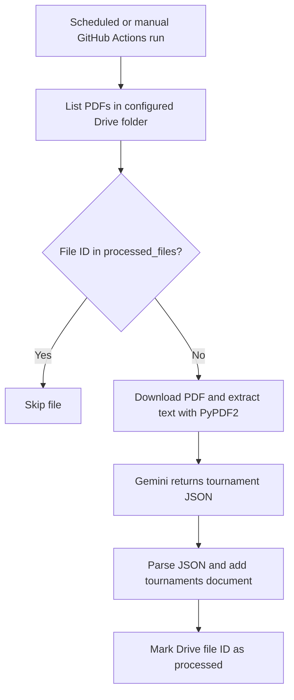

# Notabot — Tournament Collector

Notabot extracts tournament information from documents and stores it in Firebase Firestore. This repository currently contains a scheduled Python collector for PDFs in one Google Drive folder.

## Names and components

| Component | Name / identifier |
| --- | --- |
| Application | Notabot |
| GitHub repository | `amax-123/pickle-db` |
| Gemini project | Notabot (project number `625770699910`) |
| Firebase project ID | `pickleball-db` |
| Intended Firebase display name | Notabot — Pickleball DB (rename pending) |
| Current GitHub Actions workflow | Pickleball Data Sync |

Project IDs, repository name and collection names are unchanged. Display names help identify components; they do not connect services. Credentials and environment variables determine those connections.

## Current workflow

1. GitHub Actions installs the pinned dependencies and runs `main.py` using Python 3.9.
2. The script lists PDFs directly inside the configured Drive folder.
3. Previously processed Drive file IDs are skipped.
4. PyPDF2 extracts text locally. **Only that text is sent to Gemini**, not PDF images or the original PDF.
5. Gemini is asked for tournament name, dates, location, event categories, entry fees, prize money and organiser contacts.
6. The returned JSON is saved in Firestore, then the source file is marked as processed.

The model currently configured in `main.py` is `gemini-3.8-flash`. Model availability and project quotas must be checked separately.

## Files

| File | Purpose |
| --- | --- |
| `main.py` | Drive download, text extraction, Gemini request and Firestore writes |
| `requirements.txt` | Pinned Python dependencies |
| `.github/workflows/daily_sync.yml` | Scheduled and manual execution |

## Setup

Use a Firebase project with a Firestore database, a service account allowed to write to it, and a Gemini API key.

- Enable the Google Drive API in the service account's Google Cloud project.
- Share the source Drive folder with the service account email as **Viewer**.
- Create the following GitHub repository secrets under **Settings → Secrets and variables → Actions**.

| Secret | Value |
| --- | --- |
| `FIREBASE_SERVICE_ACCOUNT_KEY` | Complete service-account JSON, including its private key |
| `GEMINI_API_KEY` | Gemini API key |
| `DRIVE_FOLDER_ID` | Folder ID from the Drive URL, not the full URL |

The same service-account JSON authenticates Firestore and read-only Drive access. The Gemini key can belong to a separate Google Cloud project.

Never commit credentials, API keys or private-key JSON files. GitHub does not display a secret's saved value when editing it.

## Running and checking results

Open **Actions → Pickleball Data Sync → Run workflow** and select the default branch.

The configured cron is `0 */6 * * *`: 00:00, 06:00, 12:00 and 18:00 UTC, equivalent to 05:30, 11:30, 17:30 and 23:30 India time. Actual scheduled start times can vary.

Inspect the **Install dependencies** and **Run Extraction Script** logs. View extracted records in Firebase Console → Firestore Database → Data → `tournaments`.

A green run is not proof every file succeeded: some parsing and database errors are caught and printed without failing the job.

## Firestore records and schema

| Collection | Document ID | Contents |
| --- | --- | --- |
| `tournaments` | Firestore-generated ID | JSON fields returned by Gemini |
| `processed_files` | Drive file ID | `file_name` and `processed_at` |

The prompt requests a structure, but the script does **not** enforce a fixed schema. JSON mode requests valid JSON; `json.loads` checks JSON syntax. Neither verifies field names, data types, dates, amounts or factual accuracy. Firestore stores the supplied fields without enforcing an application schema.

The processed-file check prevents repeat processing of the same Drive ID. It does **not** deduplicate tournaments across different files.

## Current limitations

- PDFs only; Google Docs, standalone images, WhatsApp messages and links are not ingested.
- No OCR: scanned PDFs and image-only content can be missed. A page returning no extracted text can cause an error.
- Only direct folder children are queried, with no pagination or subfolder traversal.
- Changed contents under an already processed Drive ID are skipped.
- Different files describing the same tournament can create duplicate records.
- Tournament and processed-file writes are separate, so a partial failure can cause duplicate processing.
- No source link is stored on the tournament record.
- No enforced schema, conflict review, request/token cap, cost tracking or application-level retry policy.
- Download and Gemini errors can stop the run; errors inside the save block are labelled as JSON parsing errors even when caused by database writes.
- No continuous WhatsApp collector is present in this repository. Any earlier external bot needs to be located and verified separately.

## Cost status

As reported by the owner during setup:

- Firebase is on **Spark**.
- The Notabot Gemini project shows **Tier 1 · Prepay**, a paid tier.

The current script does not guarantee zero cost or enforce a spending limit. Existing processed-file checks avoid repeat Gemini calls for the same Drive ID, but new files can incur Gemini usage charges. Free-tier eligibility, quotas and any billing changes still need to be confirmed.

## Planned direction — not implemented

Keep future responsibilities identifiable without building separate services yet:

| Responsibility | Proposed label |
| --- | --- |
| Source collection from Drive and eventually WhatsApp | Notabot Collect |
| Extraction, validation and tournament deduplication | Notabot Extract |
| API and user interface | Notabot API |

Future improvements should include version-aware processing, content-hash reuse, image/Google Docs support, validated schemas, provenance, conflict review, and bounded requests/retries. Usage records can attribute work to each component using source IDs, model names, token counts and processing outcomes.

These are planning labels only. This README does not introduce services, change billing, rename cloud resources or modify the existing Python/Firebase behaviour.

