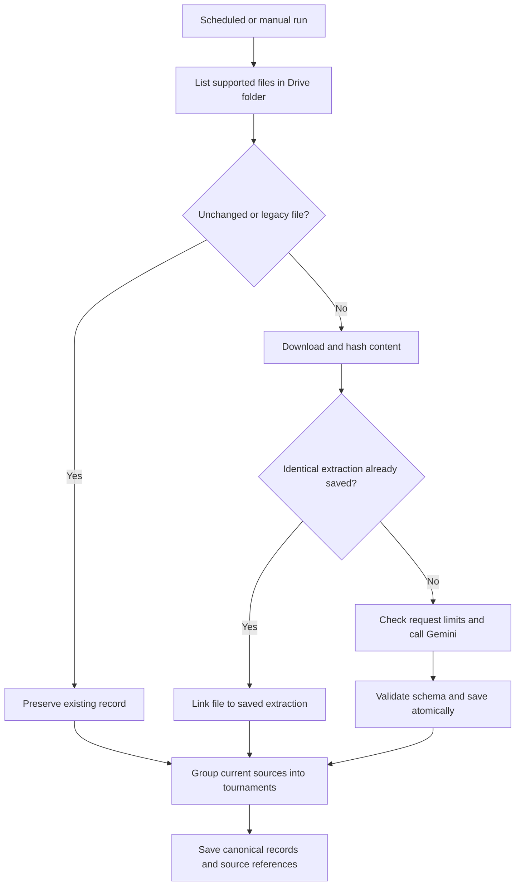

# Notabot — Tournament Collector

Notabot collects tournament documents from Google Drive, extracts structured information using Gemini, and groups related source records into tournaments in Firebase Firestore.

The current application is a scheduled Python script. WhatsApp collection, a public API and a user interface are not implemented in this repository.

## Components

| Component | Name / identifier |
| --- | --- |
| Application | Notabot |
| GitHub repository | `amax-123/pickle-db` |
| Gemini project | Notabot — project number `625770699910` |
| Firebase display name | Notabot — Pickleball DB |
| Firebase project ID | `pickleball-db` |
| Production workflow | Pickleball Data Sync |
| Extraction model | `gemini-3.5-flash-lite` |

Display names are labels. Project IDs, credentials and environment variables determine which services the script uses.

## Workflow

The script uses a Firestore lease to prevent overlapping collector runs. It paginates the configured folder's direct children; subfolders are not traversed.

| Source type | Input sent to Gemini |
| --- | --- |
| PDF | Original PDF bytes, including visual content |
| JPEG / PNG | Original image bytes |
| Google Doc | Exported plain text |

Google Docs' embedded images are not extracted separately. Standalone text files, arbitrary URLs, other image formats and WhatsApp messages are not currently supported.

## Extraction and schema

The model receives the tested prompt and a structured response schema. Python then checks required fields, value types and nonnegative finite amounts before saving.

The schema includes:

- Tournament name, other printed titles, dates and overall schedule text.
- Location, registration URLs and prize-pool wording.
- Events with sport, category, entry fee, currency, fee basis, winner/runner-up amounts, schedule and eligibility.
- Organiser contacts, rules and ambiguities.

Missing facts remain null or empty lists. Partial dates can be retained as schedule text without inventing a year. Schema validation does not establish factual accuracy or validate all date/URL semantics.

New extraction records contain `_notabot` metadata: source ID, name, URL, version, MIME type, content hash, model, schema version, token usage and review status. Content hashes include the input MIME type; reuse also depends on the model and schema version.

## Firestore collections

| Collection | Purpose |
| --- | --- |
| `tournaments` | Original legacy records and immutable new source-extraction snapshots |
| `processed_files` | Drive file IDs mapped to their current extraction records and versions |
| `canonical_tournaments` | Derived tournament groups linking their source records |
| `notabot_control` | Collector lease and daily Gemini-attempt counter |

**To view grouped results:** Firebase Console → Firestore Database → Data → `canonical_tournaments`.

Within a canonical document:

- `data` contains the selected tournament details.
- `source_record_ids` links to documents in `tournaments`.
- `source_file_ids` contains available Drive file IDs.
- `field_sources` identifies the supporting extraction records.
- `field_variants` records fields whose source values differ, with references for review.
- `matching_notes`, `review_status` and `status` describe the group.

Use records with `status = active`. Older derived groups can be marked `superseded`; they are not deleted. Source extraction records are never deleted by grouping.

### How grouping works

Grouping uses code, **not additional Gemini calls**. It compares normalised titles with dates and locations, or a shared event-specific registration URL. A registration site's homepage alone is insufficient.

Known-year records establish editions first. A yearless poster can join a uniquely matching group; ambiguous matches across editions remain separate. Explicitly conflicting dates or venues prevent automatic grouping.

The most complete source generally supplies each displayed field, with other sources filling missing fields. Explicit playing hours take priority over generic schedule descriptions. Titles, registration URLs and ambiguity lists are combined. Other differing values are referenced for review rather than silently reconciled; this is not a comprehensive event-by-event merge.

Canonical fields are generated by the script and can change when sources change. They are not a manual-editing interface. Unrelated top-level fields are retained, but editing generated fields is not a supported correction workflow yet.

## Preservation and repeat runs

- Old `processed_files` markers without a schema version are skipped unchanged. Their legacy tournament records are not automatically re-extracted or migrated.
- New unchanged files are skipped without a Gemini request.
- Identical content already extracted by this version reuses the saved snapshot.
- A changed new-format file can create a new snapshot; the previous snapshot remains intact. Grouping uses the current processed-file pointers.
- Extraction and processed-file writes are atomic. Canonical grouping is a separate transaction and can be retried independently.
- A failed request is not marked processed. A later run can retry it while skipping previously saved files.

Hash-based reuse applies to new-format snapshots. Legacy records lack hashes, so re-uploading an old document under a new Drive ID may still require extraction. Different encodings of equivalent content can also have different hashes.

## Setup and secrets

Use a Firebase project with Firestore and a service account permitted to write to it. Enable the Google Drive API in the service account's project and share the source folder with that account's email as **Viewer**.

Set these GitHub repository secrets under **Settings → Secrets and variables → Actions**:

| Secret | Value |
| --- | --- |
| `FIREBASE_SERVICE_ACCOUNT_KEY` | Complete service-account JSON |
| `GEMINI_API_KEY` | Gemini API key |
| `DRIVE_FOLDER_ID` | Folder ID only, not the full URL |

The service account authenticates Firestore and read-only Drive access. The Gemini key belongs to a separate project. Never commit credential values. GitHub does not reveal a saved secret's value when editing it.

Existing `requirements.txt` and repository secrets remain in use. Runtime optimisation and dependency cleanup have been deferred.

## Running and checking results

Open **Actions → Pickleball Data Sync → Run workflow → main** to start a new run with the latest code. Re-running an older run uses its original commit.

The cron is `0 */6 * * *`: 00:00, 06:00, 12:00 and 18:00 UTC, equivalent to **05:30, 11:30, 17:30 and 23:30 India time**. Scheduled start times can vary.

The logs show source IDs saved/skipped, extraction counts and grouping counts. Extracted contact details and credentials are not intentionally printed.

- API, transport and database failures stop processing without automatic AI retries or a paid fallback.
- Invalid/oversized files are reported while later files can continue.
- Encountered processing errors fail the workflow; successful earlier writes remain saved.
- Reaching a request/download cap leaves remaining files pending without itself failing the run. A green run therefore does not prove the entire backlog was processed.
- The existing 15-second pauses between extraction requests remain in place.

## Limits and cost controls

As confirmed by the owner on **15 October 2026**, Firebase is on **Spark** and the Notabot Gemini project is on **Free tier**, with project billing disabled.

The owner's AI Studio quota sheet listed Flash Lite at 15 requests/minute, 250,000 tokens/minute and 500 requests/day. These are recorded setup observations, not guaranteed future quotas; check AI Studio for current limits.

| Script control | Current value |
| --- | ---: |
| Gemini attempts per run | 25 |
| Collector Gemini attempts per day | 200 |
| Maximum source size | 12 MiB |
| Maximum output tokens per extraction | 16,000 |
| File downloads per run | 100 |
| Supported files scanned per run | 1,000 |
| Records read per collection for grouping | 2,000 |
| Canonical writes per grouping pass | 400 |

Daily attempts are reserved in Firestore before the API request, including failures. The counter resets by the Pacific calendar date. It measures this collector only: trial workflows and other applications do not share that counter.

Grouping scans are bounded and must be revisited as the archive grows. File-scan/grouping limits raise actionable errors rather than silently processing an incomplete grouping dataset.

The script does not enforce a project-wide token quota or monetary budget. Keep the confirmed free plans if zero spend is required; request caps do not prevent charges if billing is enabled later. Firestore reads/writes still occur during skip and grouping checks.

## Verified checkpoint

The production run [38630516178](https://github.com/amax-123/pickle-db/actions/runs/38630516178) succeeded with:

- Five source records grouped into three active tournaments.
- Three canonical records written.
- Five input files skipped during extraction.
- Zero Gemini requests and zero processing errors.

The owner confirmed the three documents were visible in Firestore. This verifies the current sample workflow, not extraction accuracy for every future document.

## Repository files

| File | Purpose |
| --- | --- |
| `main.py` | Production collection, validation, storage and grouping |
| `requirements.txt` | Existing pinned dependencies |
| `.github/workflows/daily_sync.yml` | Scheduled/manual production workflow |
| `.github/workflows/notabot_flash_lite_test.yml` | Manual five-source extraction trial; no Firestore writes |

The trial performs up to five extraction requests and uploads JSON results as a GitHub Actions artifact retained for three days. It deliberately reprocesses its fixed sample files and is not part of the production daily-attempt counter.

## Future scope — not implemented

- **Notabot Collect:** WhatsApp collection, including own messages, and additional source types.
- **Notabot Extract:** review/correction workflows, richer conflict resolution, safe legacy migration and broader validation samples.
- **Notabot API:** API, user interface and separately attributable service usage.

These are responsibility labels, not deployed services. The current application does not require model training, a vector database or an always-on server for Drive ingestion. Continuous WhatsApp hosting remains a separate decision.
